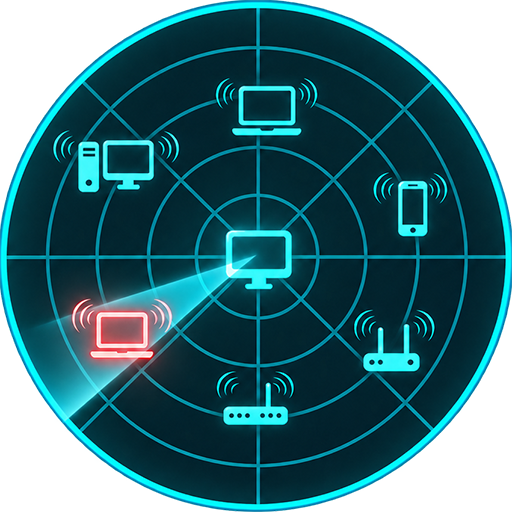

  

<h1 align="center">Metro Kafe LAN Viewer</h1>

  İnternet kafe ağı için sürekli çalışan LAN tarayıcı ve IP çakışması uyarıcısı 
  <i>A continuous LAN scanner and IP conflict watcher for internet cafés</i>

  <a href="https://github.com/cetoxQ/MetroKafeLANViewer/releases/latest"><b>⬇ İndir / Download</b></a>
  &nbsp;·&nbsp; <a href="#türkçe">Türkçe</a> &nbsp;·&nbsp; <a href="#english">English</a>

---

## Türkçe

Disksiz (ağdan açılan) istemcilerin olduğu kafelerde, elektrik kesintisinden sonra kameralar ya da başka cihazlar istemci bilgisayarların IP'lerini kapabilir; o IP'yi kaybeden bilgisayar ağdan açılamaz. Metro Kafe LAN Viewer ağı sürekli tarar, istemci IP aralığına giren yabancı cihazı anında gösterir ve uyarır. MyLanViewer benzeri, tek dosyalık bir Windows programıdır.

### Özellikler

- **Hızlı tarama:** ARP + ping, Windows adı (NetBIOS), DNS adı, açık portlar (RTSP 554, Hikvision 8000, Dahua 37777, XMEye 34567, HTTP, SMB, RDP, VNC, yazıcı, DNS) ve web arayüzü başlığı. 254 adres yaklaşık 10 saniye.
- **Üretici bulma:** MAC adresinden üretici (Wireshark üretici listesi programın içinde).
- **Tür tahmini ve simgeler:** İstemci, Bilgisayar, Kamera, Modem, Wi-Fi router, Ağ cihazı, Yazıcı, Telefon/tablet. Yanlış tahmin sağ tıkla düzeltilir, MAC'e göre hatırlanır.
- **Çakışma uyarısı:** istemci aralığındaki (ör. `192.168.2.1-110`) istemci olmayan her cihaz kırmızı şeritle, haritada kırmızı kutuyla, sesle ve bildirimle gösterilir.
- **Harita:** istemci IP'leri numaralı kutular halinde; altta ad ve simge verilen, boyutu ve yeri sürükleyerek ayarlanan **bölmeler** (sunucular, modemler, aralık dışı istemciler...). Bölmeler 20 piksellik ızgaraya oturur, yan yana ya da alt alta dizilir.
- **Toplu işlem:** Ctrl / Shift + tık ya da çerçeveyle çoklu seçim; sağ tıkla tür değiştirme, Wake-on-LAN, bölmeye taşıma, uyarıyı kapatma, silme. Seçilenler bölmelere sürüklenip bırakılabilir.
- **Otomatik tarama:** süre üstten yazılır (saniye / dakika). Pencere kapatılınca bildirim alanında çalışmaya devam eder.
- **Kayıt:** olaylar (yeni cihaz, IP değişikliği, çakışma başladı/bitti) her gün ayrı dosyaya yazılır; liste CSV olarak dışa aktarılır.
- **Kendini günceller:** yeni sürüm çıkınca program üstte "Şimdi güncelle" gösterir.

### Kurulum

1. [Son sürümden](https://github.com/cetoxQ/MetroKafeLANViewer/releases/latest) `MetroKafeLANViewer.zip` dosyasını indirin.
2. İstediğiniz bir klasöre açıp `MetroKafeLANViewer.exe`'yi çalıştırın. Kurulum ya da .NET gerekmez.
3. **Ayarlar**'da tarama aralığını ve istemci aralığını kontrol edin.

### İstemciler nasıl tanınır

Windows adı veren ve istemci aralığında olan her bilgisayar istemci sayılır ve MAC'i hatırlanır. Adların çoğu `MASA-012` gibi aynı önekle başlıyorsa, aralık dışında IP almış `MASA-067` gibi bilgisayarlar da istemci olarak tanınır. Kasa gibi başka bilgisayarlar da aralıktaysa Ayarlar'da ad kalıbı yazılabilir (ör. `^MASA`). Bilerek aralıkta duran bir cihaz için sağ tık → "Bu cihaz için uyarma".

### Kayıtlar ve komut satırı

- Ayarlar, cihazlar ve olaylar exe'nin yanındaki `veri` klasöründedir (yazılamıyorsa `%AppData%\MetroKafeLANViewer`).
- `--gizli`: bildirim alanında başlatır (Windows ile başlatma bu şekilde çalışır).
- `--guncelle`: pencere açmadan günceller, sonuç `veri\guncelleme.txt`'ye yazılır.
- Depo gizliyse güncelleme için Ayarlar → Güncelleme'ye bu depoyu okuyabilen bir GitHub anahtarı (fine-grained token, Contents: Read-only) girilir. Herkese açık depoda gerekmez.

---

## English

In cafés with diskless (network-booted) client PCs, cameras and other devices can grab a client's IP address after a power cut, and that PC then can't boot from the network. Metro Kafe LAN Viewer keeps scanning the LAN, spots any foreign device inside the client IP range right away, and alerts you. It's a single-file Windows app, similar to MyLanViewer. The interface is in Turkish.

### Features

- **Fast scanning:** ARP + ping, Windows name (NetBIOS), DNS name, open ports (RTSP 554, Hikvision 8000, Dahua 37777, XMEye 34567, HTTP, SMB, RDP, VNC, printer, DNS) and web UI title. 254 addresses take about 10 seconds.
- **Vendor lookup** from the MAC address (Wireshark's vendor list is built in).
- **Device type guessing with icons:** client, computer, camera, modem, Wi-Fi router, network device, printer, phone/tablet. Fix a wrong guess with a right-click; it's remembered by MAC.
- **Conflict alerts:** any non-client device in the client range (e.g. `192.168.2.1-110`) shows up with a red banner, a red tile on the map, a sound and a notification.
- **Map:** client IPs as numbered tiles; below them, **groups** you name, give an icon, and size and place by dragging (servers, modems, clients outside the range...). Groups snap to a 20 px grid and can sit side by side or stacked.
- **Bulk actions:** multi-select with Ctrl / Shift + click or a selection frame; right-click to change type, Wake-on-LAN, move to a group, mute warnings or delete. Drag selected devices into a group.
- **Auto scan** with a typed interval (seconds / minutes). Keeps running in the tray when the window is closed.
- **Logging:** events (new device, IP change, conflict started/ended) go to a daily file; the list exports to CSV.
- **Self-updating:** when a new release is out, the app offers "Şimdi güncelle" (Update now).

### Installation

1. Download `MetroKafeLANViewer.zip` from the [latest release](https://github.com/cetoxQ/MetroKafeLANViewer/releases/latest).
2. Extract it anywhere and run `MetroKafeLANViewer.exe`. No installer and no .NET install needed.
3. Check the scan range and client range under **Ayarlar** (Settings).

### How clients are recognized

Every PC that reports a Windows name inside the client range counts as a client, and its MAC is remembered. If most names share a prefix like `MASA-012`, PCs such as `MASA-067` that got an IP outside the range are recognized as clients too. If other PCs (e.g. the cashier) are in the range, set a name pattern in Settings (e.g. `^MASA`). For a device that's meant to be in the range: right-click → "Bu cihaz için uyarma" (don't warn for this device).

### Data and command line

- Settings, devices and events live in the `veri` folder next to the exe (or `%AppData%\MetroKafeLANViewer` if that's not writable).
- `--gizli`: start minimized to the tray (used for starting with Windows).
- `--guncelle`: update without opening a window; the result goes to `veri\guncelleme.txt`.
- While the repository is private, updates need a GitHub token that can read it (fine-grained, Contents: Read-only), entered under Settings → Update. Not needed for a public repository.

---

### Geliştirici / Developer

`yayinla.bat` bumps the version, builds, pushes the code and uploads `MetroKafeLANViewer.zip` as a GitHub release. Requires the .NET 10 SDK and a signed-in `gh`.
